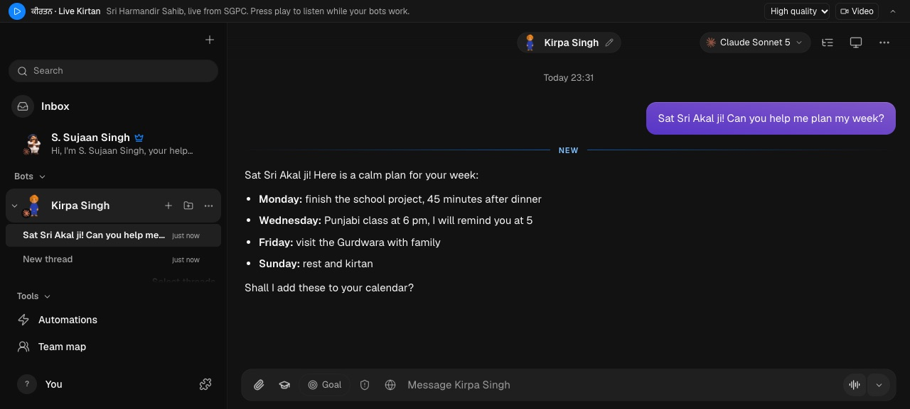
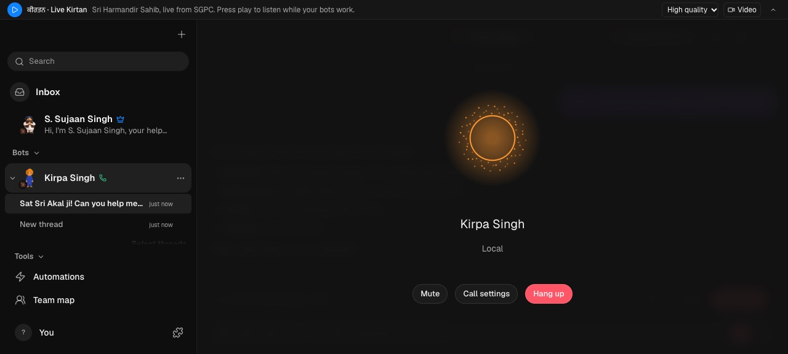
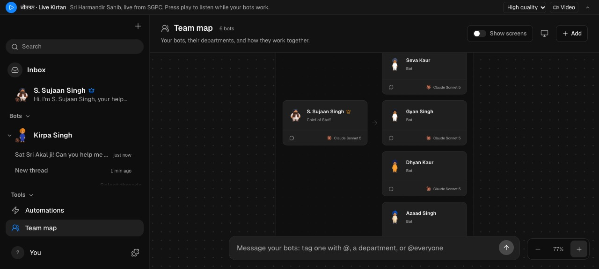

# Seva Bots

A team of AI helpers on your computer that speak Punjabi and English.

- **Voice calls in Punjabi or English.** Talk, interrupt, and hear the answer in about a second, with the Seva orb. Uses your own free Gemini key. See [Voice calls](docs/voice-calls.md).
- **Search Gurbani.** Find a shabad from a few words in Gurmukhi or roman letters. Every answer shows Ang, raag and writer.
- **Real work.** Email, files, reminders, accounts. Anything that changes your data asks you first.
- **Honest reports.** A tester bot checks each job and tells you when something failed.
- **Your choice of brain.** A free local model, or a low-cost API key such as DeepSeek.

Website: **https://sevabots.com**

## What's inside

| | |
|---|---|
| **56** built-in bot tools | Gurbani and web research, files, email drafts, reminders and routines, pages and charts, images, voice notes, memory, teamwork between bots |
| **36** computer tools | See the screen, click, type and use the browser, with your approval |
| **4** ready skills | Dashboards, social post previews, Android phone control, app testing. Bots can write and import new skills |
| **16** app languages | |
| Connected apps | Add more tools through MCP servers |

## Download

Get the latest version from [Releases](https://github.com/gurpreetsingh5523-source/seva-bots/releases/latest).

| System | File |
|---|---|
| Mac with Apple Silicon (M1 or newer) | `SevaBots-<version>-arm64.dmg` |
| Windows 10/11 | coming soon |

### Install on Mac

1. Open the `.dmg` and drag **Seva Bots** to Applications.
2. Open **Seva Bots**. The app is not yet notarized by Apple, so macOS stops it the first time. Go to **System Settings → Privacy & Security**, scroll down and click **Open Anyway** next to "SevaBots", then confirm. You only do this once.
3. Pick a brain (a local model or an API key) and say "Sat Sri Akal" to Kirpa Singh.
4. For voice calls, add a Gemini key in **Settings → API keys** (free from Google AI Studio), then press the call button in a chat.

The app checks this page for new versions and offers to update itself.

## Help

- [Voice calls](docs/voice-calls.md)
- [Approval levels](docs/approval-levels.md)
- [Choosing tools for a bot](docs/tool-selection.md)
- [Analytics and privacy](docs/analytics.md)
- [Self-hosting](docs/self-hosting.md), [your own VPS](docs/byo-vps.md), [VPS deploy](docs/deploy-vps.md), [Linux desktop](docs/linux-desktop.md)

Questions or ideas: [open an issue](https://github.com/gurpreetsingh5523-source/seva-bots/issues/new) or email hello@sevabots.com.

## Licence

Seva Bots is built on [OpenMausBot](https://github.com/milind-soni/OpenMausBot) and is released under the Apache License 2.0. See [LICENSE](LICENSE) and [NOTICE](NOTICE).

No images of the Gurus are used anywhere in this project.
